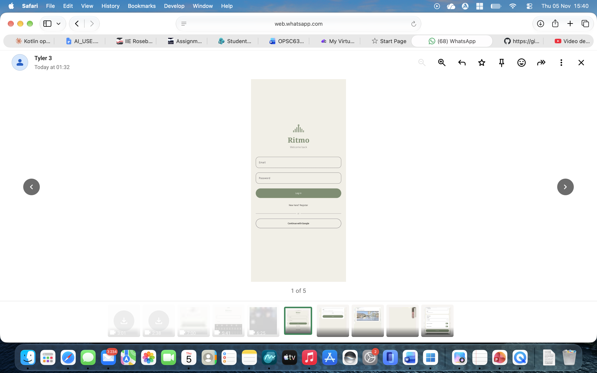
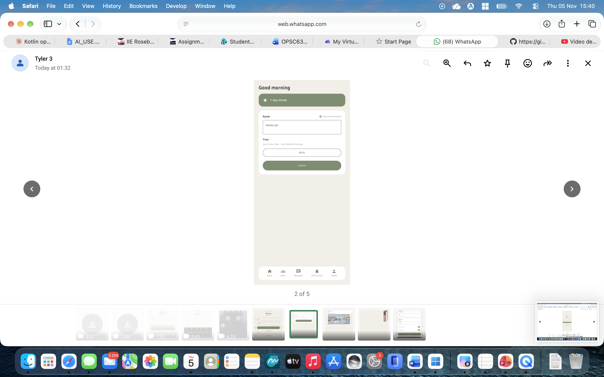
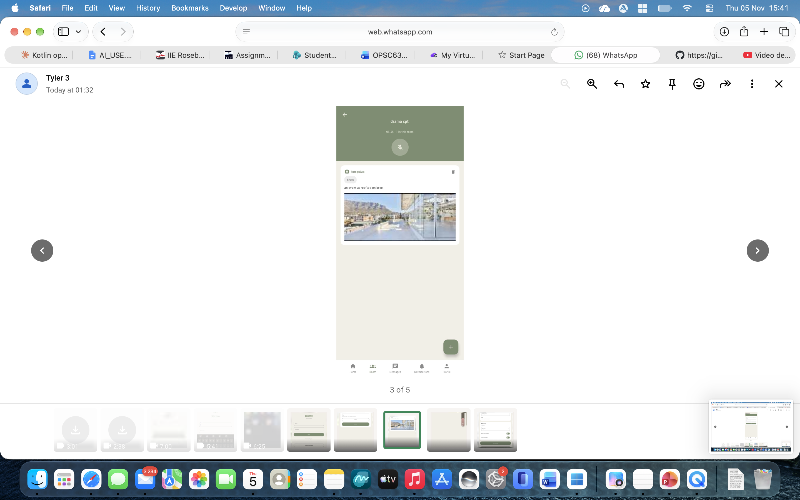
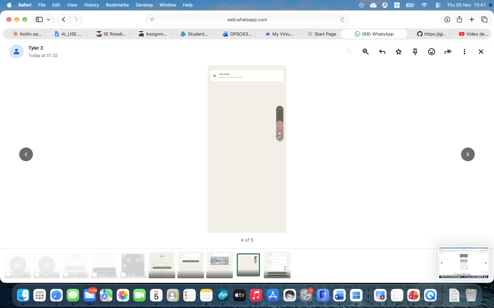
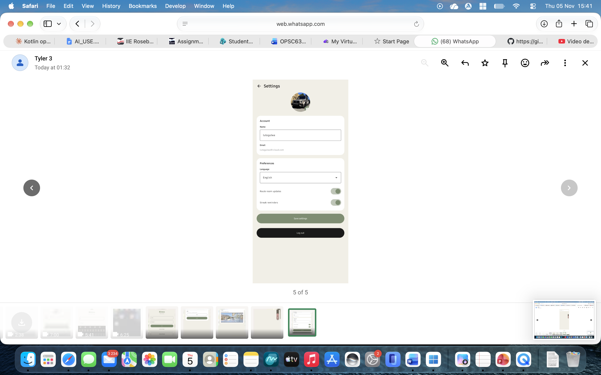

# Ritmo

<p align="center">
  
</p>

<p align="center"><b>Your commute, with company.</b><br/>
A commute-based community app for Android, built with Kotlin and Jetpack Compose.</p>


**Module:** OPSC6312 – Open Source Coding (Part 3: Final PoE)
**Student:** Sinako — The IIE's Rosebank College
**Repository:** https://github.com/Anda-AmaBhele/Ritmo
**Demo video (voice-over):** [ADD YOUR UNLISTED YOUTUBE LINK HERE](https://youtube.com)

---

## Table of contents

1. [Purpose of the app](#1-purpose-of-the-app)
2. [Screenshots](#2-screenshots)
3. [Features](#3-features)
4. [Design considerations](#4-design-considerations)
5. [Architecture and technology](#5-architecture-and-technology)
6. [Data model](#6-data-model)
7. [Offline mode with sync](#7-offline-mode-with-sync)
8. [Push notifications](#8-push-notifications)
9. [Multi-language support](#9-multi-language-support)
10. [Use of GitHub and GitHub Actions](#10-use-of-github-and-github-actions)
11. [Testing](#11-testing)
12. [Build and run](#12-build-and-run)
13. [Publishing readiness](#13-publishing-readiness)
14. [Release notes](#14-release-notes)
15. [Known limitations and future work](#15-known-limitations-and-future-work)
16. [Use of AI tools](#16-use-of-ai-tools)
17. [References](#17-references)

---

## 1. Purpose of the app

Millions of South Africans commute every day on the same route at the same time, but they never meet the people sitting next to them. Existing apps solve parts of the problem: BlaBlaCar matches drivers and passengers for one-off trips, and Nextdoor connects neighbours by address. Neither builds a **repeat, daily community around a shared commute**.

**Ritmo** fills that gap. A user saves their route and time (for example "Route 4, 07:00"). Everyone who shares that exact route and time slot is placed in the same **route room**. Because the room repeats every day, the same people meet again and again, and a community forms around the commute.

Each room has a **shared board** for practical, commute-relevant posts:

| Category | Example |
|---|---|
| Lift | "Driving from Rosebank to Sandton at 07:00, 2 seats free" |
| Accommodation | "Room open near campus from December" |
| Job | "Weekend retail work available" |
| Event | "Study group on Friday" (organic, or boosted for wider reach) |

Ritmo is not limited to students. It starts as a campus pilot with the intention to grow to all commuters.

**Target users:** students, interns and workers who travel the same route regularly.

---

## 2. Screenshots

> Screenshots were taken on a physical Android phone.

| Login | Home | Route room |
|---|---|---|
|  |  |  |

| New post | Offline sync banner | Messages |
|---|---|---|
|  |  |  |

| Notifications | Settings | isiZulu |
|---|---|---|
|  |  |  |

**Backend evidence**

| Firebase Authentication | Cloud Firestore | GitHub Actions run |
|---|---|---|
|  |  |  |

---

## 3. Features

- **Register and log in** with email and password. Passwords are hashed by Firebase Authentication and are never stored in plain text. An email verification link is sent on registration.
- **Single sign-on (SSO)** with Google Sign-In.
- **Home screen** with route, time (any 24-hour time), "use my current location" auto-fill, and a daily **streak** counter.
- **Route rooms** matched by route and time, with a live member count.
- **Room board** with Lift, Accommodation, Job and Event posts, optional photos, and Organic or Boosted event posts. Posts disappear after 24 hours to keep the board fresh.
- **Direct messages** between members, opened from a post author's profile.
- **Notifications screen** showing streak progress, new room posts and posts about to expire.
- **Settings** (profile): display name, profile picture, language, and notification preferences.
- **Offline mode with sync:** posts written without internet are saved locally and uploaded automatically when the connection returns.
- **Push notifications** using Firebase Cloud Messaging.
- **Multi-language support:** English, isiZulu and isiXhosa.
- **Input validation:** blank routes, empty posts, empty login fields and failed photo loads are handled with clear messages and never crash the app.
- **Custom app icon** and final image assets.

---

## 4. Design considerations

**Visual identity.** Ritmo uses a calm, editorial palette of sage green, cream and black with a serif title, inspired by interior-design and clothing-brand websites. The logo combines a map pin with a soundwave to represent *place* and *voice*. The design was prototyped in Canva before being built in Jetpack Compose.

**Usability.**
- One main action per screen, large touch targets and a persistent bottom navigation bar.
- Friendly error messages (for example "Write something before posting") instead of technical errors.
- The time picker accepts any 24-hour time because commuters do not only travel in the morning.

**Privacy and safety.**
- Passwords are handled only by Firebase Authentication.
- Users only see a first name derived from their email, a route and a streak on a public profile card.
- Posts expire after 24 hours.

**Resilience.** Commuters often have weak or no signal (taxis, trains, tunnels). Ritmo was therefore designed to keep working offline for its core action, posting to the board, and to sync automatically afterwards.

**Inclusion.** South Africa is multilingual, so the interface can be switched to isiZulu or isiXhosa at any time without restarting manually.

**Consistent room identity.** A room ID is built from the route and time. The words "General" and "Anytime" used as fallbacks are kept in English in all languages, so users of different languages still land in the same room.

---

## 5. Architecture and technology

| Layer | Technology |
|---|---|
| Language | Kotlin |
| UI | Jetpack Compose, Material 3 |
| Authentication | Firebase Authentication (email/password + Google Sign-In) |
| Database | Cloud Firestore (NoSQL, accessible via Firebase's REST/gRPC API) |
| Push notifications | Firebase Cloud Messaging (FCM) |
| Local storage | SQLite (offline queue) and SharedPreferences (language) |
| Location | Google Play Services Fused Location + Geocoder |
| CI/CD | GitHub Actions |
| Minimum SDK | 24 (Android 7.0) |

**Why Firebase instead of a custom REST API?** The brief allows an existing API from the internet. Firebase provides authentication, a NoSQL database and push messaging as one managed service, and Cloud Firestore is exposed through Google's documented REST and gRPC endpoints. This removed the need to run my own server while still meeting the requirement for an API connected to a database.

**Navigation.** The app uses a simple state-based router in `MainActivity` (Login, Home, Room, Post, Messages, Chat, Notifications, Profile) with a remembered "origin" screen so the back button always returns the user to where they came from.

**Project structure**

```
app/src/main/java/com/example/ritmo/
├── MainActivity.kt              // router, language wrapper, FCM permission
├── LocaleHelper.kt              // saves and applies the chosen language
├── OfflineDb.kt                 // SQLite queue for offline posts
├── SyncManager.kt               // detects connectivity and syncs the queue
├── RitmoMessagingService.kt     // receives push notifications
├── RitmoUtils.kt                // helpers (room IDs, streaks, expiry)
└── ui/                          // Compose screens
    ├── LoginScreen.kt
    ├── HomeScreen.kt
    ├── RouteRoomScreen.kt
    ├── PostToBoardScreen.kt
    ├── MessagesListScreen.kt
    ├── ChatScreen.kt
    ├── NotificationScreen.kt
    └── ProfileScreen.kt
app/src/main/res/
├── values/strings.xml           // English
├── values-zu/strings.xml        // isiZulu
└── values-xh/strings.xml        // isiXhosa
```

---

## 6. Data model

Cloud Firestore collections:

| Collection | Document ID | Key fields |
|---|---|---|
| `users` | Firebase Auth UID | `displayName`, `homeRouteName`, `preferredTimeWindow`, `streakCount`, `language`, `roomUpdatesEnabled`, `streakRemindersEnabled`, `profilePictureBase64`, `fcmToken` |
| `rooms` | route + time | `routeName`, `timeWindow`, `memberIds[]` |
| `posts` | auto-generated | `roomId`, `authorId`, `authorName`, `category`, `content`, `isBoosted`, `imageBase64`, `createdAt` |
| `conversations` | sorted pair of user IDs | `participantIds[]`, `participantNames{}`, `lastMessage`, `lastMessageAt` |
| `conversations/{id}/messages` | auto-generated | `senderId`, `text`, `sentAt` |

**Composite indexes** (created in the Firebase console):
- `posts`: `roomId` (ascending) + `createdAt` (descending)
- `conversations`: `participantIds` (array contains) + `lastMessageAt` (descending)

**Security rules.** Only signed-in users can read or write data:

```
rules_version = '2';
service cloud.firestore {
  match /databases/{database}/documents {
    match /{document=**} {
      allow read, write: if request.auth != null;
    }
  }
}
```

> These rules are suitable for this assessment. Before a public launch they would be tightened so that users can only edit their own documents.

**Images.** Photos are resized and compressed on the device, then stored as Base64 text inside the Firestore document. This keeps the project on Firebase's free Spark plan, which does not include Cloud Storage.

---

## 7. Offline mode with sync

1. When the user taps **Post**, `PostToBoardScreen` checks connectivity using `SyncManager.isOnline()`.
2. If offline, the post is written to a local **SQLite** table (`pending_posts`) through `OfflineDb`, and the user sees: *"You're offline. Post saved and will upload when you reconnect."*
3. The room screen shows a banner: *"1 post(s) waiting to sync."*
4. `SyncManager` registers a `NetworkCallback`. When the network returns, it uploads every queued post for the logged-in user to Firestore, keeping the **original time the user wrote it**, then deletes it from the local queue.
5. The banner disappears and the post appears on the board.

Previously loaded posts also stay readable offline because Firestore caches them on the device.

Everything is logged with `Log.d` and `Log.e` under the tags `RitmoOfflineDb`, `RitmoSync` and `RitmoOffline`.

---

## 8. Push notifications

- `RitmoMessagingService` extends `FirebaseMessagingService`.
- On launch the app asks for the Android 13+ notification permission, creates a notification channel (`ritmo_updates`), and saves the device's **FCM token** to the user's Firestore document.
- Messages sent from the Firebase console (or a server) arrive as system notifications. When the app is open, `onMessageReceived` builds the notification itself.
- Tapping the notification opens the app.

---

## 9. Multi-language support

| Language | Resource folder |
|---|---|
| English (default) | `values/strings.xml` |
| isiZulu | `values-zu/strings.xml` |
| isiXhosa | `values-xh/strings.xml` |

The user picks a language in **Settings**. `LocaleHelper` stores it in SharedPreferences and wraps the activity context in `attachBaseContext` so every `stringResource()` call uses the chosen language. The screen is recreated immediately after the change.

> The isiZulu and isiXhosa translations should be reviewed by a first-language speaker before a public release.

---

## 10. Use of GitHub and GitHub Actions

### Version control
- The project is stored in a GitHub repository initialised with this README.
- Work was committed in small steps with descriptive messages (for example "Add multi-language support and offline mode with sync") and pushed regularly.
- A merge was needed when the remote repository contained commits the local copy did not have (the workflow file was created on GitHub first). The merge was completed and pushed.
- The final commit is tagged **`final-PoE`**.

### GitHub Actions (continuous integration)
The workflow `.github/workflows/build.yml` (named **Android CI**) runs automatically on every push and pull request to `master` or `main`:

| Step | What it does |
|---|---|
| Check out the code | `actions/checkout@v4` |
| Set up JDK 17 | `actions/setup-java@v4` (Temurin, Gradle cache) |
| Make gradlew executable | `chmod +x ./gradlew` |
| **Run unit tests** | `./gradlew testDebugUnitTest` |
| **Build debug APK** | `./gradlew assembleDebug` |
| Upload the APK | `actions/upload-artifact@v4` (artifact `ritmo-debug-apk`) |

This proves the app **builds and its tests pass on a clean machine**, not just on my computer. A duplicate workflow created earlier was removed so each push triggers a single run.


### Secrets and safety
- The signing keystore (`.jks`) is **never committed**; it is excluded through `.gitignore`.
- Only the compiled, signed APK is attached to the GitHub Release.

---

## 11. Testing

- **Unit tests** (`RitmoUtilsTest`) cover the helper functions in `RitmoUtils.kt`, such as room ID creation and post expiry.
- Tests run automatically in GitHub Actions on every push.
- **Manual testing** was done on a physical Android phone: register, log in, Google sign-in, post, offline post and sync, push notification, language switching, invalid input and screen rotation.

Run the tests locally:

```bash
./gradlew testDebugUnitTest
```

---

## 12. Build and run

1. Clone the repository: `git clone https://github.com/Anda-AmaBhele/Ritmo.git`
2. Open it in **Android Studio** (Giraffe or newer).
3. Add your own `google-services.json` from a Firebase project with Authentication (Email/Password and Google), Firestore and Cloud Messaging enabled, in the `app/` folder.
4. Create the Firestore indexes listed in [section 6](#6-data-model).
5. Run on a physical Android device (Android 7.0 or newer).

---

## 13. Publishing readiness

The app is prepared for the Google Play Store:

- [x] Unique application ID (`com.example.ritmo`) — to be changed to a final package name before a public release
- [x] Custom launcher icon (adaptive icon)
- [x] Version code and version name set (`1`, `1.0`)
- [x] Release build **signed** with my own keystore
- [x] Runtime permissions requested with clear context (location, notifications)
- [x] Screenshots taken on a physical device
- [ ] Google Play Console upload (internal testing track) — *[update this line with your evidence]*

**Evidence**

| Signed APK | Play Console |
|---|---|
| Attached to the [GitHub release](https://github.com/Anda-AmaBhele/Ritmo/releases) |  |

---

## 14. Release notes

The full list is in [RELEASE_NOTES.md](RELEASE_NOTES.md). Summary of **v1.0.0 (Final PoE)** compared with the prototype:

**Innovative features added in this version**
- Offline mode with automatic sync (SQLite queue and connectivity listener)
- Push notifications (Firebase Cloud Messaging)
- Multi-language support: isiZulu and isiXhosa

**Other updates**
- Settings screen with live language switching and scrolling
- GitHub Actions pipeline with automated unit tests
- New app icon and final assets
- Firestore rules and indexes fixed
- Stronger input validation

---

## 15. Known limitations and future work

- The **microphone button in each room is a UI prototype**. Live audio (for example Agora or WebRTC) is the next step and is not part of this submission.
- Photos are stored as Base64 in Firestore, which is fine for small images but would move to Cloud Storage at scale.
- Security rules are permissive for signed-in users and need tightening before launch.
- Group chats and communities, paid rides, a marketplace and an iOS version are planned.
- Translations need a native-speaker review.

---

## 16. Use of AI tools

AI assistance (Claude by Anthropic) was used for code snippets, debugging errors and drafting translations. The full write-up (maximum 500 words) is in [AI_USE.md](AI_USE.md).

---

## 17. References

- Android Developers (2024) *Save key-value data with SharedPreferences*. Available at: https://developer.android.com/training/data-storage/shared-preferences (Accessed 5 November 2026).
- Android Developers (2024) *Save data using SQLite*. Available at: https://developer.android.com/training/data-storage/sqlite (Accessed 5 November 2026).
- Android Developers (2024) *Monitor connectivity status and connection metering*. Available at: https://developer.android.com/training/monitoring-device-state/connectivity-status-type (Accessed 5 November 2026).
- Android Developers (2024) *Language and locale resources*. Available at: https://developer.android.com/guide/topics/resources/localization (Accessed 5 November 2026).
- Firebase (2024) *Receive messages in an Android app*. Available at: https://firebase.google.com/docs/cloud-messaging/android/receive (Accessed 5 November 2026).
- Firebase (2024) *Cloud Firestore documentation*. Available at: https://firebase.google.com/docs/firestore (Accessed 5 November 2026).
- Firebase (2024) *Authentication documentation*. Available at: https://firebase.google.com/docs/auth (Accessed 5 November 2026).
- GitHub (2024) *Automated build Android app with GitHub Action*. Available at: https://github.com/marketplace/actions/automated-build-android-app-with-github-action (Accessed 5 November 2026).
- Nextdoor (2022) *Nextdoor strengthens neighborhood connections*. Available at: https://www.businesswire.com/news/home/20220215005549/en (Accessed 23 August 2026).
- TechCrunch (2017) *BlaBlaCar unveils BlaBlaLines, a new app for daily commutes*. Available at: https://techcrunch.com/2017/05/02/blablacar-unveils-blablalines-a-new-app-for-daily-commutes (Accessed 23 August 2026).
